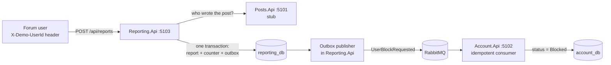
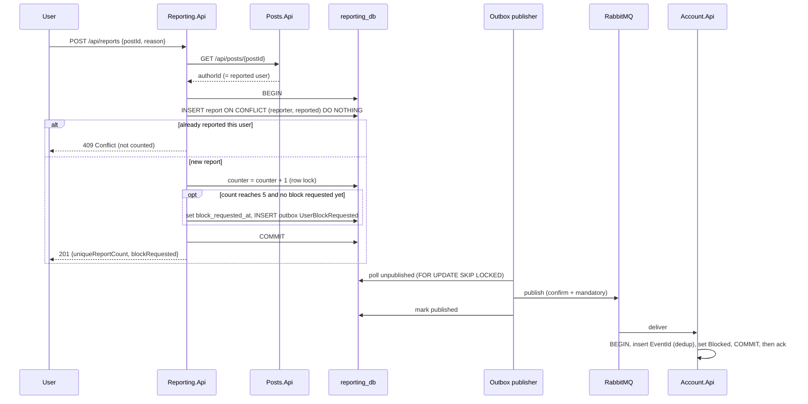

# Forum Reporting: Prototype

A working .NET 11 prototype of a forum moderation feature:

1. A logged-in user can report another user **only once**, however many posts that user has. Duplicates don't increase the count.
2. Each report identifies a **post by the reported user** and includes a **reason**.
3. When **five different users** report a user, that user's account is **blocked**.

It is a demo, not production code. The full system design (Part 1) is in [`diagrams/`](diagrams/). This repository implements a
simplified version of it. How AI agents were used is in [`AI_WORKFLOW.md`](AI_WORKFLOW.md).

## Architecture



More detail is in [`docs/architecture.mmd`](docs/architecture.mmd).

| Service | Owns | Responsibility |
|---|---|---|
| **Reporting.Api** (new) | `reporting_db`: reports, per-user counters, outbox | Accepts reports, prevents duplicates, counts distinct reporters, detects the 5th, and publishes `UserBlockRequested` through a transactional outbox |
| **Account.Api** (stands in for the existing Account service) | `account_db`: accounts, processed messages | Consumes `UserBlockRequested` exactly once per event and sets the account to `Blocked`. Exposes the account status |
| **Posts.Api** (stub of the existing Posts service) | in-memory posts | Returns a post and its author, so Reporting knows whom a report targets |
| **Contracts** | n/a | The `UserBlockRequested` v1 event, broker topology names and shared JSON options. No logic |

Each service owns its database. Reporting never touches `account_db`; the only link between them is the event.

### Report flow



## Key design choices and trade-offs

**Duplicate prevention.** The database enforces it with a unique index on `reports (reporter_user_id, reported_user_id)`.
`PostId` is not part of the key, so reporting a *different* post by the same user is still a duplicate. The insert uses
`ON CONFLICT DO NOTHING`, so two simultaneous identical requests can't both succeed: the second waits for the first and then
sees the conflict. A check in application code ("SELECT, then INSERT") would let both through under concurrency.

**Blocking threshold.** Reporting keeps a per-user counter that is incremented **in the same transaction** as the report insert,
and only when the insert really happened. The counter row is locked by the upsert, so simultaneous reports against the same user
are applied one after another and no increment is lost. While that lock is held, exactly one transaction sees `count = 5` with no
block requested yet; it sets `block_requested_at` and writes the event. The block event is therefore created **exactly once**.
Alternative: running `COUNT(*)` on every report is simpler, but concurrent transactions can both see 5 unless the table is locked.

**Transactional outbox.** The event is saved in the same transaction as the 5th report. A background worker publishes it later
(with broker confirms, and failing if no queue receives it) and marks it published. If RabbitMQ is down, reports still succeed
and the block is applied when it comes back. This is shown in the demo. Delivery is **at-least-once**, so Account deduplicates
by `EventId`.

**Asynchronous blocking.** This decouples the services and survives broker outages, at the cost of **eventual consistency**:
for up to about 2 s after the 5th report (the outbox poll interval; about 1 s in the demo runs) the account is still `Active`. During that time it is effectively "BlockPending", which
Reporting shows as `blockRequestedAt` in its summary endpoint. A synchronous call to Account would be immediately consistent, but
it would couple the services and fail reports whenever Account is down.

## Assumptions

- **Blocking** means the account's status becomes `Blocked` in Account.Api (`GET /api/accounts/{id}/status`). Enforcing it
  (refusing login, revoking sessions) belongs to the identity and other services and is not implemented.
- The **reported user is the post's author**, as returned by the Posts service. The client cannot choose the target, and the
  reporter comes only from the authenticated identity.
- **Self-reporting** is rejected (422).
- Only the **first** report per (reporter, reported user) is stored and counted. Later ones get 409.
- A report counts once it is **committed**. Reports are never withdrawn, so the count never goes down. There are no appeals, unblocking or moderator review.
- The threshold is **5** (configurable as `Reporting:BlockThreshold`). Reports after the 5th are still stored and counted, but no second block event is created.
- User and post IDs are opaque, **case-sensitive** strings (like an identity provider's `sub`).
- A reason is required: 3-500 characters, it must contain a letter or digit, and control characters other than newline and tab are not allowed.
- **Authentication is a demo stand-in:** the `X-Demo-UserId` header is trusted as-is and only works in Development or Testing. In the
  full design, an API Gateway and Identity Service issue tokens that each service validates.
- The response returns `uniqueReportCount` because the task plan asked for it. In a real forum this would tell reporters how close a user is to being blocked.

## Run it

Prerequisites: .NET SDK 11 and Docker Desktop.

```powershell
docker compose -f deploy/docker-compose.yml up -d      # PostgreSQL :5433, pgAdmin :5050, RabbitMQ :5672 / UI :15672
./scripts/start-services.ps1                            # builds, starts Posts :5101, Account :5102, Reporting :5103
./scripts/demo.ps1                                      # resets demo data and runs the whole scenario
```

Or start the services manually: `dotnet run --project src/Services/<Posts|Account|Reporting>.Api`. Both services apply
their database migrations on startup, and Account seeds the demo users (`target-1`, `target-2`, `reporter-1..6`).

The demo shows:
- 401 when not logged in, 422 for a self-report, 404 for an unknown post, 400 for an empty reason;
- four reporters → count 4;
- `reporter-1` reporting a **different** post by the same author → **409**, count stays 4;
- the 5th reporter → `blockRequested: true`;
- `target-1` becoming **Blocked** about 1 s later.

You can also click through the requests in [`demo.http`](demo.http).

**Broker outage demo:**
1. `docker stop forum-reporting-rabbitmq-1`
2. Run `./scripts/demo.ps1`. The reports succeed, and the account stays Active while the block request waits in the outbox.
3. `docker start forum-reporting-rabbitmq-1`
4. The account becomes Blocked within a few seconds.

Web UIs:
- **RabbitMQ:** http://localhost:15672 (`forum` / `forum`)
- **pgAdmin:** http://localhost:5050 (password `forum` for the preconfigured server)

`deploy/postgres/init.sql` only runs on an empty volume. Use `docker compose -f deploy/docker-compose.yml down -v` to start from scratch.

## Test it

```powershell
dotnet test --solution ForumReporting.slnx    # needs Docker running (Testcontainers starts PostgreSQL and RabbitMQ)
```

88 tests. The ones that cover the core requirements, against **real PostgreSQL / RabbitMQ**:

| Requirement | Test |
|---|---|
| Duplicate on a different post isn't counted | `ReportPersistenceTests.Same_reporter_on_a_different_post_by_the_same_author_is_a_duplicate_and_not_counted`, `ReportsEndpointTests.Same_reporter_on_another_post_by_same_author_is_409_and_not_counted` |
| 4 reporters → no block; 5th → exactly one block event | `Four_distinct_reporters_count_4_and_no_block`, `Fifth_distinct_reporter_creates_exactly_one_block_event_and_later_reports_do_not` |
| Concurrency | `Concurrent_reports_from_the_same_reporter_store_one_report_and_count_once` (20 parallel), `Concurrent_reports_from_different_reporters_are_all_counted_and_block_is_requested_once` (10 parallel) |
| All-or-nothing transaction | `Failure_in_the_last_step_rolls_back_report_counter_and_block_request_together` |
| Event published | `OutboxPublishingTests.Block_request_is_published_to_the_account_queue_and_marked_published` |
| Account blocked, redelivery ignored | `BlockUserTests.Event_blocks_the_account_once_and_redelivery_changes_nothing`, `Published_event_is_consumed_and_status_endpoint_shows_Blocked` |

Unit tests cover validation, demo authentication, the Posts client and how outcomes map to HTTP status codes.

## Repository layout

```
src/BuildingBlocks/Contracts     UserBlockRequested v1, topology names, shared JSON options
src/Services/Reporting.Api       Auth/ Posts/ Reports/ Persistence/ Outbox/
src/Services/Account.Api         Accounts/ Messaging/ Persistence/
src/Services/Posts.Api           in-memory stub
tests/                           Reporting.UnitTests, Reporting.IntegrationTests, Account.IntegrationTests
deploy/docker-compose.yml        PostgreSQL 17 + pgAdmin + RabbitMQ 4.4
scripts/                         start-services.ps1, demo.ps1
docs/architecture.mmd            implemented architecture; docs/ai-log/ = per-iteration AI log
diagrams/                        Part 1 system design
```

## Not implemented / next steps

- Real authentication (an identity provider with JWT validation) and a moderator role for the summary endpoint.
- Enforcing `Blocked` at login and on protected actions, and publishing a `UserBlocked` event for other services
  (notifications, support tools). Both are part of the Part 1 design.
- Moderator review, report withdrawal, appeals and unblocking. Any of these would require decrementing the counter in the same transaction.
- A shared messaging building block, instead of the identical topology code copied into both services.
