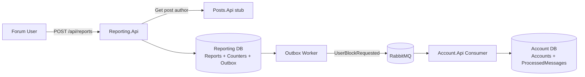

# Forum Reporting Feature — Prototype Plan

## 1. Goal

Build a small .NET prototype for a forum moderation feature:

1. An authenticated user can report another user's post with a reason.
2. The same reporter can report the same reported user only once, even when reporting different posts.
3. When **five distinct users** report the same user, that user's account is blocked.

The aim is to demonstrate correct business rules, database consistency, and basic event-driven communication—not to build a production-ready forum.

## 2. Recommended technology

- **.NET 11 / ASP.NET Core** — Web APIs and background workers.
- **EF Core + PostgreSQL** — persistence, transactions, unique constraints.
- **RabbitMQ** — asynchronous events between services.
- **Docker Compose** — run PostgreSQL and RabbitMQ locally both with web ui interfaces.
- **xUnit** — automated tests.
- **Testcontainers** — optional, for integration tests against real PostgreSQL/RabbitMQ.

## 3. Prototype architecture

Implement two business services and one lightweight stub for an existing forum service:

| Service | Responsibility | Status |
|---|---|---|
| **Reporting.Api** | Accept reports, validate them, prevent duplicates, maintain the distinct-reporter count, detect the fifth report, and publish a block request | New |
| **Account.Api** | Own account status; consume a block request and change the account to `Blocked` | New prototype service representing an existing Account Service |
| **Posts.Api** | Return a post and its author ID so Reporting.Api can determine whom the report concerns | Small stub representing an existing Posts Service |

Use separate databases or schemas owned by each service. For a local prototype, one PostgreSQL container can host two databases: `reporting_db` and `account_db`. **Reporting.Api must never update Account.Api's database directly.**

### Implemented interaction



## 4. Main request and event flow

1. The client submits `POST /api/reports` with `postId` and `reason`.
2. Reporting.Api gets the reporter ID from the authenticated identity. It must not trust a reporter ID or reported-user ID supplied in the request body.
3. Reporting.Api asks Posts.Api for the post's author. The author's ID is the reported-user ID.
4. Reporting.Api rejects self-reporting and invalid/nonexistent posts.
5. In one PostgreSQL transaction, Reporting.Api:
   - inserts the report;
   - increments the reported user's counter only when the insert is new;
   - when the count first reaches five, inserts a `UserBlockRequested` message into the Outbox.
6. An Outbox background worker publishes the event to RabbitMQ and marks it as published after broker confirmation.
7. Account.Api consumes the event, records its event ID to prevent duplicate processing, and changes the account status to `Blocked` in one local transaction.

The report and outbox event are committed together. Publishing happens afterward, so a broker outage does not lose the block request. Delivery is treated as **at least once**; consumers must be idempotent.

## 5. Data model and critical rules

### Reporting database

- **Reports**: `Id`, `ReporterUserId`, `ReportedUserId`, `PostId`, `Reason`, `CreatedAt`.
- **ReportedUserCounters**: `ReportedUserId`, `UniqueReportCount`, `BlockRequestedAt`, `UpdatedAt`.
- **OutboxMessages**: `Id`, `EventType`, `Payload`, `CreatedAt`, `PublishedAt`, `Attempts`.

Enforce the business rule in PostgreSQL, not only in application code:

```sql
CREATE UNIQUE INDEX ux_reports_reporter_reported
ON reports (reporter_user_id, reported_user_id);
```

Insert with `ON CONFLICT DO NOTHING` (or handle the unique-constraint violation). Increment the counter only if the report was actually inserted. Use an atomic counter upsert and a conditional update such as `BlockRequestedAt IS NULL` to ensure only one block request is created.

### Account database

- **Accounts**: `UserId`, `Status`, `BlockedAt`, `BlockReason`.
- **ProcessedMessages**: `EventId`, `ProcessedAt`, with a unique constraint on `EventId`.

### Event contract

`UserBlockRequested` should contain at least `EventId`, `UserId`, `ReportCount`, `Reason`, and `RequestedAt`. Account.Api owns the actual account status change. It may publish a `UserBlocked` event after the change if other services need to react.

## 6. API and local authentication

Minimum endpoints:

- `POST /api/reports` — body: `{ "postId": "...", "reason": "Harassment" }`.
- `GET /api/accounts/{userId}/status` — inspect the account status for the demo.

For local demonstration only, use a development authentication handler that reads an `X-Demo-UserId` header and creates the user identity. Clearly document that this is **not production authentication**; production would use a trusted identity provider and validated access tokens.

Suggested responses:

- `201 Created` — report accepted; include the unique report count and whether blocking is pending.
- `409 Conflict` — reporter has already reported that target user.
- `404 Not Found` — post does not exist.
- `400` or `422` — invalid input or self-reporting.

## 7. Assumptions to document

- A user cannot report themselves.
- The reported user is the author of the supplied post; the client cannot choose the target user directly.
- Only the first report by a given reporter against a given target is stored and counted. A later report against another post by that target is a duplicate.
- A report is counted after it is successfully committed to the Reporting database.
- Blocking means setting account status to `Blocked`; the prototype exposes that status. Production services would also enforce it on login and protected actions, including handling existing tokens.
- Blocking is asynchronous. After the fifth report is committed, the account may briefly show `BlockPending` until Account.Api processes the event.
- No report appeal, report withdrawal, automatic unblocking, or moderator review is implemented unless time permits.

## 8. Tests to implement

Use real PostgreSQL for tests of uniqueness, transactions, and concurrency; EF Core's InMemory provider does not reproduce those database guarantees.

Essential tests:

1. First report is stored and the counter becomes 1.
2. Same reporter reports a different post by the same author: duplicate; counter remains unchanged.
3. Four distinct reporters: count is 4; account remains active.
4. Fifth distinct reporter: count is 5; exactly one block event is placed in the Outbox.
5. Account.Api consumes the event: account becomes `Blocked`.
6. Re-delivering the same event does not repeat processing.
7. Two concurrent reports from the same reporter produce one stored report and one counter increment.
8. Concurrent reports from different reporters are both counted correctly.

## 9. Suggested repository layout

```text
ForumReporting/
├── src/
│   ├── Services/
│   │   ├── Reporting.Api/
│   │   ├── Account.Api/
│   │   └── Posts.Api/
│   └── BuildingBlocks/Contracts/   # event contracts only
├── tests/
│   ├── Reporting.UnitTests/
│   ├── Reporting.IntegrationTests/
│   └── Account.IntegrationTests/
├── deploy/docker-compose.yml
├── docs/architecture.mmd
├── AI_WORKFLOW.md
├── README.md
└── ForumReporting.sln
```

## 10. Build order and timebox

Prioritize a working core before adding infrastructure:

1. **Project setup and Docker Compose** — create solution/projects; start PostgreSQL and RabbitMQ.
2. **Posts.Api stub and Reporting.Api** — implement post lookup and report endpoint.
3. **Reporting persistence and transaction** — unique index, atomic counter, threshold detection, and Outbox insert.
4. **Account.Api and messaging** — consume `UserBlockRequested`, update account, and deduplicate events.
5. **Tests** — especially duplicate reports, five distinct reporters, and concurrency.
6. **Documentation and demo** — README, architecture diagram, AI workflow, and repeatable demo.

If time is short, prioritize the three functional requirements and tests. A direct local call to a blocking application handler can be a temporary fallback, but document it as a simplification; the target design is asynchronous messaging with an Outbox.

## 11. Run and demonstrate

Typical local workflow (adjust project paths/ports to the implementation):

```bash
docker compose -f deploy/docker-compose.yml up -d

dotnet run --project src/Services/Posts.Api
dotnet run --project src/Services/Account.Api
dotnet run --project src/Services/Reporting.Api

dotnet test
```

Seed one target user, five reporter users, and several posts belonging to the target. Submit reports using five different `X-Demo-UserId` values. Submit a second report from the first reporter against a different post by the same author to demonstrate that it is rejected and not counted. After the fifth distinct reporter, query the Account.Api status endpoint and show `Blocked`.

## 12. AI-assisted workflow deliverable

Create `AI_WORKFLOW.md` with real examples from the work:

- **Architect agent:** reviewed requirements and proposed service boundaries, schema, and event contract.
- **Developer agent:** generated a small, focused implementation task (for example, report transaction or Outbox worker).
- **Test agent:** proposed duplicate, threshold, and concurrency tests.
- **Reviewer agent:** reviewed race conditions, transaction boundaries, event idempotency, and security.

For each example record the tool/agent, prompt, output, how it was tested, and what you changed or rejected. Do not claim an agent-generated result works until you have run the tests yourself.

## 13. Interview talking points

Be ready to explain these choices:

- **Unique database constraint:** prevents duplicate reports even when concurrent requests race.
- **Atomic counter + transaction:** ensures only newly inserted reports increment the count.
- **Transactional Outbox:** avoids losing the block request between committing the report and publishing to RabbitMQ.
- **Idempotent consumer:** safely handles at-least-once message delivery.
- **Service ownership:** Reporting owns reports and counters; Account owns account status; Posts owns post authorship.
- **Trade-off:** asynchronous blocking improves decoupling and resilience but introduces eventual consistency and a short `BlockPending` period.

The prototype does not need a full API Gateway, Identity Provider, Notification Service, support dashboard, cloud deployment, or production-grade observability.
